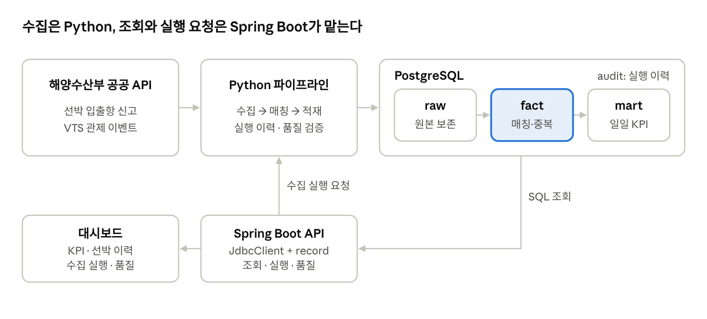

> 이 글은 화면 확인용 샘플이며 공개되지 않습니다(`draft: true`). 본문 내용과 수치는 실제 경험이 아닙니다.

## 제목과 문단

본문 검색 확인용 단어는 `샘플본문키워드` 입니다. [내부 링크](/resume.html)와 [외부 링크](https://www.postgresql.org/docs/)를 함께 확인합니다.

### 3단계 제목

#### 4단계 제목

4단계 제목은 앵커를 가지지만 목차에는 표시되지 않습니다.

## 코드 블록

```sql
-- 언어 라벨과 구문 강조, 복사 버튼을 확인합니다
SELECT category, count(*) AS total
FROM sample_table
WHERE created_at >= DATE '2026-01-01'
GROUP BY category
ORDER BY total DESC;
```

```python
def sample(values: list[int]) -> int:
    """긴 줄의 가로 스크롤을 확인합니다."""
    return sum(value for value in values if value % 2 == 0) + len("이 줄은 가로 스크롤을 확인하기 위해 일부러 아주 길게 작성한 코드 줄입니다 ------------------------------")
```

```
언어를 지정하지 않은 코드 블록
```

## 표

| 항목 | 설명 | 예시 값 |
| --- | --- | --- |
| A | 줄바꿈이 필요한 긴 문장도 표 안에서 읽을 수 있는지 확인합니다 | 1 |
| B | 짧은 설명 | 2 |

## 이미지



## 인용문과 목록

> 인용문 표시를 확인합니다.

- 순서 없는 목록
  - 중첩 목록
- `인라인 코드`가 포함된 항목

1. 순서 있는 목록
2. 두 번째 항목
